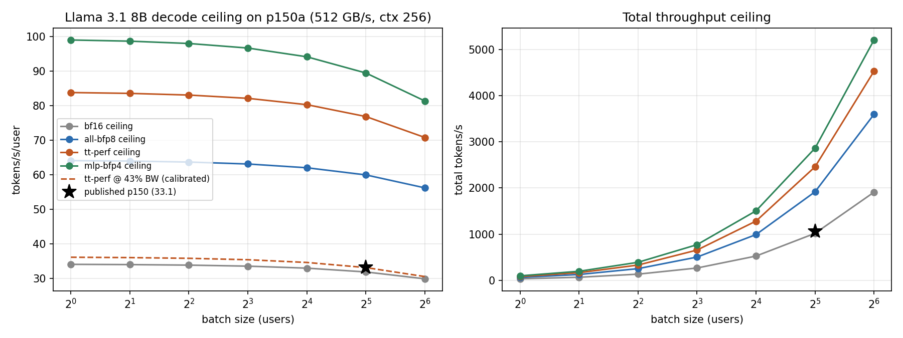
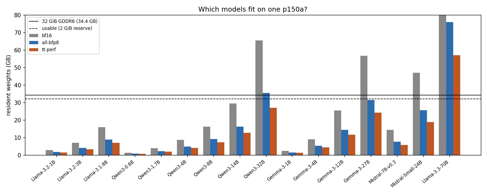
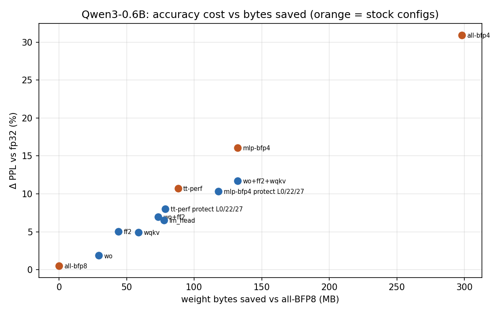
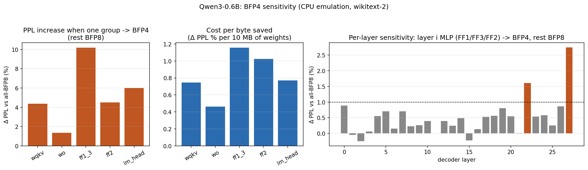
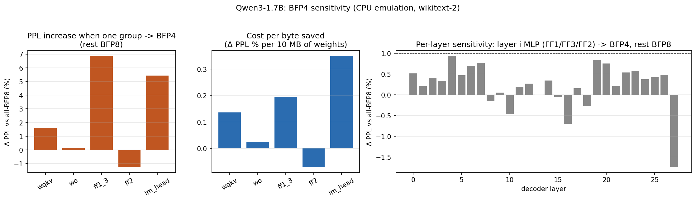

# blackhole-llm

**Running and optimizing open-weight LLMs on a single Tenstorrent Blackhole p150a.**


A student research project by **KEYEAST**, the computer science club at Changwon Science High School (Korea).
Team: Mugyeong Bae (lead), Junyoung Oh, Rinha Kim, Yujun Lee.

> **Status: Phase 0 (pre-hardware analysis + CPU accuracy emulation) complete.** Everything below comes from analytical models and
> CPU emulation, calibrated against Tenstorrent's published numbers. **No result in this repo was
> measured on a Blackhole card yet.** Hardware measurements will be added under `bench/` and marked as such.

---

## Why this project

LLM decode is memory-bound: every generated token streams the full weight set from DRAM.
The p150a has 32 GB GDDR6 at 512 GB/s, 120 Tensix cores with 1.5 MB L1 SRAM each (180 MB total),
and native block-float formats (BFP8/BFP4) that cut weight bytes by 1.9×/3.6× compared with BF16.
We want to measure how close a single card can get to its bandwidth ceiling, and what each
optimization (data format, L1 placement, kernel fusion, trace) actually buys.

## Phase 0 findings (analytical, pre-hardware)

**1. The published baseline uses ~43% of peak DRAM bandwidth, so there is ~2.3× headroom.**
Tenstorrent reports Llama 3.1 8B on p150 at **33.1 t/s/u, batch 32** (tt-metal `v0.64.0-dev20251030`).
With the `tt-perf` format mix (BFP4 FF1/FF3, BFP8 elsewhere) one decode step moves **6.67 GB**
(weights plus the KV cache of 32 users), i.e. **221 GB/s effective, 43% of 512 GB/s**. The bandwidth ceiling for the same
configuration is **76.8 t/s/u**. Sanity check: if the weights were BF16, the published number would
need 104% of peak, which is impossible, so the demo really is running compressed formats.



**2. What fits on one card.** Resident weight bytes (decimal GB; ~~struck~~ = exceeds 32 GiB minus a 2 GiB reserve):

| Model | BF16 | all-BFP8 | tt-perf | MLP-BFP4 | KV cache left @ tt-perf (users × 4k ctx) |
|---|---:|---:|---:|---:|---:|
| Llama 3.1 8B | 16.1 | 9.0 | 7.1 | 6.2 | 87 |
| Qwen3 8B | 16.4 | 9.3 | 7.5 | 6.6 | 77 |
| Qwen3 14B | 29.5 | 16.4 | 12.9 | 11.1 | 54 |
| Gemma 3 12B | 25.5 | 14.5 | 11.7 | 10.3 | 23 |
| Mistral Small 24B | ~~47.1~~ | 25.7 | 19.0 | 15.6 | 37 |
| Gemma 3 27B | ~~56.8~~ | 31.5 | 24.3 | 20.8 | 7 |
| Qwen3 32B | ~~65.5~~ | ~~35.5~~ | 27.1 | 23.0 | 8 |
| Llama 3.3 70B | ~~141~~ | ~~75.9~~ | ~~57.2~~ | ~~47.8~~ | — |

32B-class models fit **only** with BFP4 MLPs, and then leave room for just ~8 concurrent 4k-token users.
Full table for 16 models: [`results/fit.md`](results/fit.md). Decode ceilings: [`results/decode_ceiling.md`](results/decode_ceiling.md).



**3. "Keep weights in L1" only works for small models, so Phase 2 has to be about prefetching.**
One Llama 3.1 8B decoder layer is 221 MB in BFP8 and 117 MB in BFP4, while aggregate L1 is 180 MB.
Only ≤4B models fit more than 3 layers in L1 at BFP4 ([`results/l1.md`](results/l1.md)). For 8B+ models the
realistic L1 strategy is double-buffered layer-ahead weight prefetch, with the KV cache and activations sharded across cores.
We refined our Phase 2 plan accordingly.

**4. Block-float error depends on outlier *direction*, not just format.** CPU emulation of TT `bfp8_b`/`bfp4_b`
([`bfp.py`](bfp.py), block = one 16-element face row, shared 8-bit exponent):

| Weight distribution | BF16 | BFP8 | BFP4 |
|---|---:|---:|---:|
| Gaussian | 55.6 dB | 43.1 dB | 19.0 dB |
| Student-t (ν=3, heavy tail) | 55.5 dB | 40.1 dB | 16.6 dB |
| 1% outlier **input** channels ×10 | 55.6 dB | 43.1 dB | 19.0 dB |
| 1% outlier **output** channels ×10 | 55.6 dB | 39.8 dB | 16.4 dB |

TT tiles share exponents along the *output* dimension of `Wᵀ`, so input-channel outliers are free while output-channel
outliers cost ~3 dB. BFP4 sits around 16 to 19 dB SQNR (≈11 to 15% RMS weight error), which is why we test BFP4 per
layer and per tensor group instead of globally. Truncation instead of round-to-nearest costs a further 4.6 to 5.8 dB
([`results/bfp_synthetic.md`](results/bfp_synthetic.md)).

**5. On a real model, the stock `tt-perf` mix is not on the accuracy/bytes Pareto front.**
We fake-quantized every linear weight of **Qwen3-0.6B** to TT block formats ([`ppl.py`](ppl.py), weights only) and measured
wikitext-2 perplexity on GitHub Actions (32k tokens, ctx 512; fp32 reference PPL 27.69).

| Config | Weight bytes saved vs all-BFP8 | Δ PPL vs fp32 |
|---|---:|---:|
| all-BFP8 | 0 MB | +0.5% |
| `tt-perf` (stock: BFP4 FF1/FF3) | 88.1 MB | +10.7% |
| `tt-perf`, but layers 0/22/27 kept BFP8 | 78.6 MB | +8.0% |
| MLP all BFP4 (`mlp-bfp4`) | 132.1 MB | +16.1% |
| **`mlp-bfp4`, but layers 0/22/27 kept BFP8** | **118.0 MB** | **+10.3%** |
| **BFP4 for WO + FF2 + WQKV, FF1/FF3 kept BFP8** | **132.1 MB** | **+11.7%** |
| all BFP4 | 298.0 MB | +30.9% |

- **Tensor-group sensitivity:** with everything else at BFP8, moving one group to BFP4 costs (Δ PPL per 10 MB saved)
  FF1/FF3 1.16% > FF2 1.02% > LM head 0.77% ≈ WQKV 0.75% > WO 0.46%. FF1/FF3 is both the largest group and the most
  expensive per byte, yet it is the one the stock mix compresses.
- **Layer sensitivity:** dropping a single layer's MLP to BFP4 costs <1% for 26 of 28 layers. The outliers are
  **layer 27 (last, +2.7%)** and **layer 22 (+1.6%)**, with layer 0 next (+0.9%) (8k-token sweep, noise ≈ ±0.3%).
- **Consequences:** keeping just 3 of 28 layers at BFP8 saves *more* bytes than `tt-perf` (118 vs 88 MB) at *lower* loss
  (+10.3% vs +10.7%). At equal bytes to `mlp-bfp4`, compressing attention + FF2 instead of FF1/FF3 cuts the loss from
  +16.1% to +11.7%. Since decode is bandwidth-bound, bytes saved convert directly into decode speed (finding 1),
  so a per-layer, per-group format search is worth doing on hardware.




Caveats: one small model, one corpus. Small models are known to be more sensitive to quantization than 8B-class ones.
KV-cache and activation formats and math fidelity are not emulated. Next: Qwen3-1.7B/4B and Llama 3.2 on the same pipeline.
Raw tables: [`results/ppl_Qwen3-0.6B_*.md`](results/).

**6. Replication on Qwen3-1.7B: the group ranking holds, the layer ranking does not.**
Same pipeline, same budget (fp32 reference PPL 20.76).

| Config | Qwen3-0.6B Δ PPL | Qwen3-1.7B Δ PPL |
|---|---:|---:|
| all-BFP8 | +0.5% | +0.05% |
| `tt-perf` (BFP4 FF1/FF3) | +10.7% | +6.9% |
| `mlp-bfp4` (BFP4 FF1/FF3/FF2) | +16.1% | **+5.0%** |
| all-BFP4 | +30.9% | +12.7% |
| one group → BFP4: FF1/FF3 / LM head / WQKV / WO / FF2 | +10.7 / +6.5 / +4.9 / +1.9 / +5.0% | +6.9 / +5.5 / +1.7 / +0.2 / **−1.2%** |

- **Consistent across sizes:** the larger model is ~2× less sensitive overall, and FF1/FF3 and the LM head remain the most
  damaging groups to put in BFP4 while WO stays nearly free. Format choice should be made per tensor group.
- **Not consistent:** on 1.7B no single layer's MLP costs more than 1% at BFP4, and the last layer, the most sensitive one
  on 0.6B, shows the opposite sign. A protected-layer set therefore has to be searched per model and cannot be copied across sizes.
- **Anomaly to check:** BFP4 FF2 *lowers* wikitext-2 perplexity on 1.7B (also visible as `mlp-bfp4` beating `tt-perf`).
  Quantization noise can act as a regularizer on one corpus. We will re-test with a second corpus and logit KL divergence
  before reading anything into it.



## Repository

| Path | What |
|---|---|
| [`roofline.py`](roofline.py) | Model zoo (16 configs), memory footprint, KV budget, bandwidth-bound decode ceiling, L1 residency, calibration vs published numbers |
| [`bfp.py`](bfp.py) | CPU emulator for TT `bfp8_b` / `bfp4_b` (shared-exponent block float) + synthetic error study |
| [`ppl.py`](ppl.py) | Perplexity of any HF causal LM with weights fake-quantized per tensor group (`wqkv`, `wo`, `ff1_3`, `ff2`, `lm_head`) |
| [`plot_ppl.py`](plot_ppl.py) | Sensitivity and Pareto figures from the `ppl.py` result tables |
| [`.github/workflows/ppl.yml`](.github/workflows/ppl.yml) | Runs `ppl.py` experiments in parallel on GitHub-hosted runners and commits the results |
| [`tests/test_ppl.py`](tests/test_ppl.py) | Smoke test of the fake-quant pipeline on a tiny random Llama (no download) |
| [`bench/reproduce_baseline.sh`](bench/reproduce_baseline.sh) | Phase 1 hardware script: reproduce the published Llama 3.1 8B p150 number |
| `results/`, `figures/` | Generated outputs (regenerate with the commands below) |

```bash
pip install -r requirements.txt
python roofline.py                     # fit / ceiling / L1 tables + figures
python bfp.py                          # BFP emulator self-check + synthetic study
python ppl.py --model Qwen/Qwen3-0.6B --text data/wikitext2_test.txt   # accuracy per format mix (heavy: prefer the workflow)
python plot_ppl.py Qwen3-0.6B          # figures from results/ppl_*.md
gh workflow run ppl.yml -f model=Qwen/Qwen3-1.7B   # run the default experiment set in the cloud
```

`roofline.py` and `bfp.py` run built-in `assert` self-checks before producing output; the workflow runs `tests/test_ppl.py` first.

## Roadmap

- [x] **Phase 0 · Pre-hardware analysis**: footprint/KV model, bandwidth ceiling calibrated to published p150 data, L1 residency analysis, BFP emulator
- [x] **Phase 0b · Accuracy emulation (Qwen3-0.6B)**: format mixes, tensor-group and per-layer BFP4 sensitivity, protected-layer mixes
- [x] **Phase 0c · Replication on Qwen3-1.7B**: group ranking holds, layer ranking is model-specific
- [ ] **Phase 0d**: second corpus + logit KL divergence; Llama 3.2 1B/3B, Gemma 3 1B; test whether per-layer sensitivities add up
- [ ] **Phase 1 · Bring-up**: TT-Metalium/TT-NN + vLLM plugin; reproduce 33.1 t/s/u; validate the fit table on real allocator limits
- [ ] **Phase 2 · Optimization**
  - [ ] Per-layer format search (BFP4 MLP / BFP8 attention / sensitive-layer exceptions), using `ppl.py` for ranking
  - [ ] Layer-ahead weight prefetch into L1, KV/activation sharding over 120 cores
  - [ ] Custom reader/compute/writer kernels: overlap NoC0/NoC1 data movement with FPU/SFPU; fuse ops to cut DRAM round-trips
  - [ ] Metal Trace + trace-region tuning for decode dispatch
- [ ] **Phase 3 · Evaluation**: t/s/u, t/s, TTFT, tokens/W across batch × sequence length, each step vs baseline and vs available GPUs

## Assumptions and limits

- Decode is modeled as purely bandwidth-bound: `step = (weights + batch × ctx × KV/token) / BW`. Compute, dispatch and NoC contention are folded into one efficiency factor calibrated at batch 32.
- `tt-perf` mirrors `ModelOptimizations.performance` in tt-metal `models/ttt_compat/tt/model_config.py`; LM-head precision (BFP8) is our assumption.
- 2 GiB DRAM reserve and the 256-token average decode context are placeholders until measured.
- Gemma 3 KV is an upper bound (sliding-window layers counted as global). Vision towers excluded.
- `ppl.py` emulates weight formats only; KV-cache format, activation formats and math fidelity need hardware.

## 한국어 요약

창원과학고 컴퓨터 동아리 **KEYEAST**의 Tenstorrent Blackhole p150a 단일 카드 LLM 추론 최적화 연구입니다.
현재는 하드웨어 이전 단계(Phase 0)로, 해석적 모델과 CPU 에뮬레이션을 이용해 다음을 확인했습니다.
(1) 공개된 Llama 3.1 8B 성능(33.1 t/s/u)은 메모리 대역폭의 약 43%만 사용하므로 최적화 여지가 약 2.3배 남아 있습니다.
(2) 32B급 모델은 MLP를 BFP4로 줄여야만 32GB에 들어갑니다.
(3) 8B 이상 모델은 레이어 하나도 L1(180MB)에 다 들어가지 않으므로, L1은 가중치 상주보다 프리페치 용도로 써야 합니다.
(4) BFP 블록 포맷의 오차는 이상치 채널의 방향에 따라 달라집니다.
(5) Qwen3-0.6B 실험에서 Tenstorrent 기본 설정(tt-perf)은 정확도 대비 절약 바이트 측면에서 최적이 아니었습니다. 민감한 레이어 3개(0, 22, 27)만 BFP8로 두면 기본 설정보다 바이트는 더 줄이면서(118MB 대 88MB) 정확도 손실은 더 작았습니다(+10.3% 대 +10.7%).

## License

MIT. Hardware and software names are trademarks of their respective owners; this is an independent student project, not affiliated with Tenstorrent.
